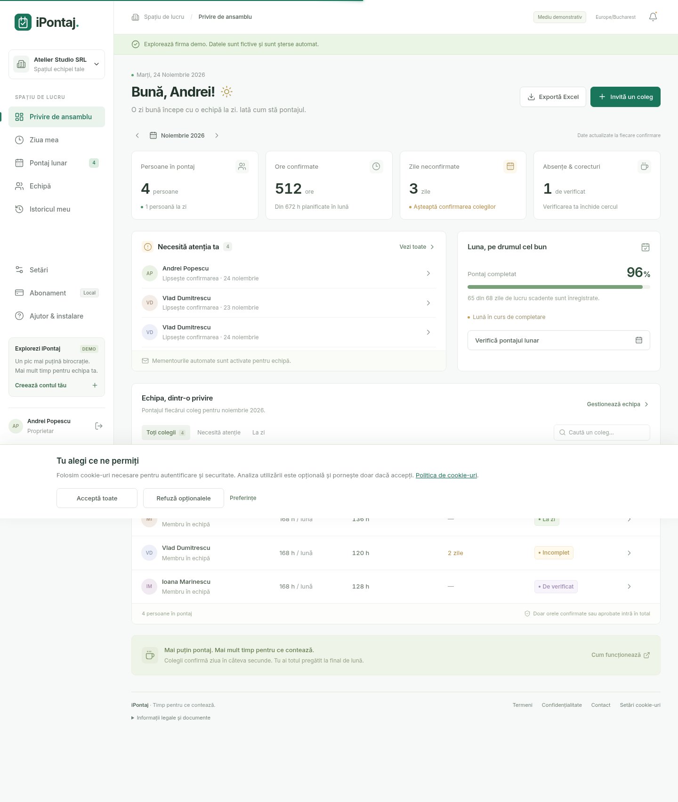
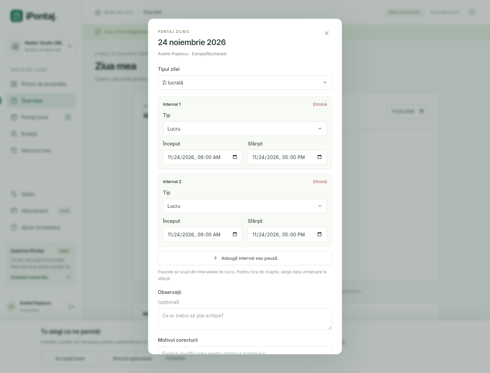

# iPontaj

**Pontaj în limba română pentru echipe mici. Confirmi ziua, verifici luna, exporți pentru contabil.**

[Contribuie](CONTRIBUTING.md) · [Susține proiectul](FUNDING.md) · [Securitate](SECURITY.md) · [Documentație](docs/README.md) · [AGPL-3.0-only](LICENSE)



## Starea proiectului

Prima versiune funcțională, în dezvoltare. Fluxurile principale sunt implementate și verificate local; serviciul comercial nu este încă lansat. Stripe funcționează exclusiv în test, iar încasările live sunt blocate. Paginile juridice sunt pregătite pentru verificarea și completarea demersurilor de lansare.

- `develop`: integrarea contribuțiilor și a funcțiilor noi; propune pull requesturile aici.
- `master`: versiunea de referință verificată, actualizată din `develop`.

Un push în repository nu publică aplicația și nu activează plăți. Repositoryul își păstrează vizibilitatea stabilită de proprietar.

## Funcționalități

- Conturi cu nume și prenume separate, parole cu reguli comune pe server și indicator de siguranță, recuperare și autentificare în doi pași.
- Firme izolate, proprietari și angajați, apartenențe multiple și invitații individuale cu expirare/revocare.
- Colegi fără email și fără cont, cu asumarea explicită a pontajului de către proprietar; orele sunt înregistrate și aprobate de responsabil.
- CIF și denumire salvate împreună; căutare în serviciul public ANAF, cu completare manuală marcată ca neverificată când serviciul nu răspunde.
- Configurare personală fără CIF pentru consumatori.
- Programe istorice, intervale multiple, pauze, ture de noapte și schimbările orei.
- Confirmări ale angajatului, aprobări ale proprietarului, corecturi cu motiv și audit.
- Verificare, închidere și redeschidere a lunii; exporturi Excel și JSON limitate la firma autorizată.
- Mementouri și exporturi către contabil prin cozi, cu linkuri semnate și expirare.
- Demo cu date fictive, izolat per vizitator, și PWA fără cache pentru pontaje sau exporturi autentificate.
- Checkout și portal Stripe de test, webhookuri semnate și deduplicate.
- Documente juridice, acceptări cu versiune și dovadă, formular de retragere și registrul cererilor GDPR.

Pontajul este pentru verificare și prelucrare de către contabil. Diferențele de ore nu determină automat drepturi salariale. Nu pretindem import verificat în SAGA sau SmartBill.

## Cerințe

| Componentă          | Versiune / observații                                                                                                                       |
| ------------------- | ------------------------------------------------------------------------------------------------------------------------------------------- |
| PHP                 | 8.3+; Composer 2                                                                                                                            |
| Node.js             | 24 LTS, minimum 24.11; versiunea majoră este în `.nvmrc`                                                                                    |
| Bază de date locală | SQLite cu `pdo_sqlite`                                                                                                                      |
| Alte baze           | MySQL/MariaDB sau PostgreSQL, cu driverul PDO corespunzător; verifică versiunea serverului înainte de deploy                                |
| Extensii PHP        | Extensiile Laravel și PhpSpreadsheet, inclusiv `mbstring`, `bcmath`, `dom`, `xml`, `xmlreader`, `xmlwriter`, `gd`, `zip`; `intl` recomandat |
| Python              | Python 3 pentru verificarea secretelor și regenerarea notificărilor de licență                                                              |

Laravel 13, Vue 3, TypeScript, Inertia 3, Tailwind CSS, Laravel Cashier și PhpSpreadsheet. Versiunile exacte sunt în `composer.lock` și `package-lock.json`.

## Instalare pentru dezvoltare

Pe o clonă nouă, într-un director fără date de producție:

```bash
git clone --branch develop https://github.com/banarares/ipontaj.git
cd ipontaj
cp .env.example .env
composer install
php artisan key:generate
touch database/database.sqlite
php artisan migrate
npm ci
npm run build
php artisan serve --host=127.0.0.1 --port=8000
```

Accesează **http://127.0.0.1:8000**. Pentru repository privat ai nevoie de acces GitHub acordat de proprietar. Dacă folosești nvm, rulează `nvm install` și `nvm use` înainte de comenzile npm.

`.env.example` nu conține acreditări. Nu înlocui `.env` și nu regenera `APP_KEY` pe o instalare existentă. Vechea aplicație Laravel din istoricul repositoryului nu are o migrare de producție validată către această versiune: testează pe o bază nouă și pregătește separat orice transfer al datelor existente.

### Dezvoltare cu reîncărcare automată

```bash
composer run dev
```

Sau pornește separat serverul PHP, `npm run dev`, workerul și schedulerul:

```bash
php artisan queue:work --tries=3 --timeout=90
php artisan schedule:work
```

Implicit, `MAIL_MAILER=log`: emailurile nu sunt expediate extern. Tratează logurile ca date private, deoarece pot conține linkuri de invitație și informații personale. Nu le atașa la un issue fără anonimizare.

### Încearcă fluxul principal

1. Deschide demo-ul din pagina de start sau creează un cont de test.
2. Configurează firma prin CIF ori alege utilizarea personală; confirmă programul și acordurile aplicabile.
3. Invită o persoană cu o adresă fictivă și acceptă invitația într-o sesiune separată.
4. Confirmă ziua sau ajustează intervalele și absențele.
5. Verifică luna și descarcă Excelul. Aprobarea unei luni încheiate cere rezolvarea înregistrărilor lipsă și a excepțiilor.

În formularul „Invită un coleg”, opțiunea „Colegul nu are adresă de email” permite adăugarea directă în echipă, cu nume, prenume, începutul pontajului și confirmarea responsabilității. Nu creează cont sau email fictiv; colegul ocupă un loc în plan. Proprietarul îi completează orele din Pontaj lunar.

Pentru o zi anterioară datei inițiale a pontajului, proprietarul poate confirma în editor că persoana era deja activă și trebuie să scrie motivul corectării începutului. Acțiunea este auditată; nu elimină pauzele de inactivitate și nu schimbă luni aprobate fără redeschiderea lor. Înregistrarea retroactivă într-o perioadă deja activă funcționează fără această extindere.



[Interfață mobilă](docs/screenshots/employee-mobile.png) · [Parole și înregistrare](docs/screenshots/register-password-desktop.png) · [Pagini juridice](docs/screenshots/legal-desktop.png)

## Verificări înainte de un pull request

Simbolul folosit în interfață este `public/favicon.svg`. După modificarea lui, rulează `npm run branding:build` pentru a regenera pictogramele PWA, Apple Touch, ICO și simbolul din imaginea socială. Comanda folosește Chromium instalat prin Playwright (`npx playwright install chromium`) sau calea din `CHROME_PATH`; fișierele rezultate sunt incluse în repository și nu cer Chromium pe găzduire. Imaginile de partajare `public/branding/social-card.svg` și `.png` sunt folosite de metadatele SEO.

```bash
python3 scripts/check-secrets.py
php vendor/bin/phpunit --no-progress
npm run test:passwords
composer lint:check
composer types:check
npm run types:check
npm run check
npm run build
```

Pentru verificarea exclusivă a fișierelor pregătite de commit: `python3 scripts/check-secrets.py --staged`. Scannerul nu afișează valorile detectate. Este o verificare suplimentară, nu o garanție că orice tip de informație sensibilă poate fi identificat automat.

Într-un mediu care blochează procesele/socketurile locale pentru analiza paralelă:

```bash
php vendor/bin/phpstan analyse --debug --no-progress
php vendor/bin/pint --test
```

Testele browser creează date fictive: folosește o bază dedicată de dezvoltare/test, cu serverul pornit. Exemplu:

```bash
npx playwright install chromium
BASE_URL=http://127.0.0.1:8000 node tests/browser/smoke.mjs
BASE_URL=http://127.0.0.1:8000 node tests/browser/owner-employee.mjs
BASE_URL=http://127.0.0.1:8000 node tests/browser/password-and-names.mjs
BASE_URL=http://127.0.0.1:8000 node tests/browser/company-lookup.mjs
BASE_URL=http://127.0.0.1:8000 node tests/browser/legal.mjs
BASE_URL=http://127.0.0.1:8000 node tests/browser/managed-attendance.mjs
```

Pentru un Chromium existent, setează `CHROME_PATH`. Nu rula aceste fluxuri pe producție. Testele PHP izolează baza și cheile Stripe; verificarea externă Stripe este o operațiune separată, numai în test. Raportul și limitele verificării sunt în [docs/VERIFICATION.md](docs/VERIFICATION.md).

## Contribuții

Caută o problemă în [Issues](https://github.com/banarares/ipontaj/issues), discută schimbările ample și deschide un pull request către `develop`. Începători: traduceri românești, accesibilitate, documentație, verificare Safari/iOS și experiența pe mobil. Pentru reguli de acces, calcule de timp și concurență sunt necesare teste de comportament relevante.

Vezi [CONTRIBUTING.md](CONTRIBUTING.md) pentru arhitectură, procedura de lucru și verificările cerute. Raportează vulnerabilitățile privat, conform [SECURITY.md](SECURITY.md).

## Susținerea dezvoltării și marketingului

Dorim să finanțăm dezvoltarea și promovarea iPontaj, cu prioritate pentru găsirea și înțelegerea primilor utilizatori. Canalul preferat este **GitHub Sponsors**, după activarea profilului beneficiarului. Nu publicăm un link de încasare ca fiind activ până când acesta nu este verificat.

[Planul de finanțare și transparență](FUNDING.md) descrie prioritățile, propunerea de buget și pașii de activare. Poți contribui și prin cod, documentație, testare sau recomandarea proiectului către echipe mici și contabili, fără comunicări nesolicitate în masă.

## Instalare proprie și serviciul găzduit

Instalarea proprie are implicit `BILLING_ENABLED=false` și o limită configurabilă prin `SELF_HOSTED_SEAT_LIMIT`. Serviciul comercial propus are plan Gratuit pentru 5 persoane și Echipă pentru 15 persoane, **49 lei/lună, preț final**. Operatorul indicat pentru iPontaj.ro este BANA RARES-NICOLAE PFA, neînregistrat în scopuri de TVA. O contribuție la proiect este distinctă de achiziția unui abonament.

Pentru producție: [operare și date](docs/OPERATIONS.md), [Stripe](docs/BILLING.md), [pregătirea juridică](docs/LEGAL_LAUNCH.md). Datele publice ale operatorului sunt intenționat afișate în paginile juridice; acreditările, datele clienților și configurarea mediului nu aparțin repositoryului.

## Pachet privat pentru cPanel

Utilitarul local al operatorului se rulează cu `python3 .local-tools/backup_for_cpanel.py`. Scriptul și rezultatele din `backup/` sunt ignorate de Git și nu sunt distribuite prin repository. Pachetul include aplicația cu dependențe de producție, un export MySQL verificat și backupul original al bazei. `.env` și configurarea secretă sunt gestionate separat. Vezi [ghidul de deploy](docs/CPANEL_DEPLOY.md).

## Licență și sursa corespunzătoare

Codul original este sub **AGPL-3.0-only**. Vezi [LICENSE](LICENSE) și [THIRD_PARTY_NOTICES.md](THIRD_PARTY_NOTICES.md); dependențele își păstrează licențele. Proiectul folosește [starter kitul oficial Laravel Vue](https://github.com/laravel/vue-starter-kit).

La fiecare release, după instalarea dependențelor și ultimele modificări:

```bash
python3 scripts/update-third-party-notices.py
php artisan pontaj:source:build
php artisan pontaj:legal:check
```

Arhiva oferită la `/cod-sursa` exclude configurarea secretă și datele runtime. Verificarea juridică raportează demersurile de lansare neconfirmate; generarea paginilor sau a arhivei nu certifică îndeplinirea lor.

## Cloudflare și paginile publice

Turnstile pentru autentificare, înregistrare și contact, preferințe pentru cookie-uri și pregătirea indexării se configurează prin `.env`. [Ghidul Cloudflare și SEO](docs/CLOUDFLARE_SEO.md) descrie cheile, proxy-urile de încredere, analiza opțională și pașii Search Console. Integrările sunt dezactivate implicit; datele de test și cheile locale rămân în afara repositoryului.
